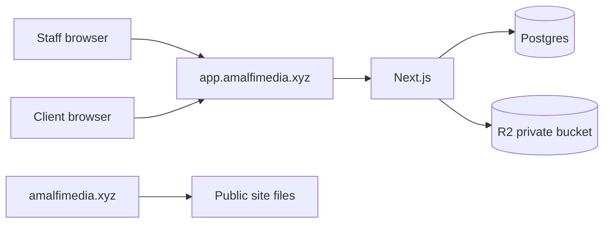

# Architecture

One Next.js App Router app. Admin and portal are route areas, not separate deployments.

```text
app.amalfimedia.xyz  ->  Next.js
  /admin             staff shell
  /portal            client shell
  /_next             Next.js assets on this host

amalfimedia.xyz      ->  existing public site, untouched
```

There is no `basePath` and no `assetPrefix`. Pages are real URL segments. Asset URLs are root-relative (`/_next/...`), which is correct because the app has its own host. A Playwright check requests `/admin/login` with `Host: app.amalfimedia.xyz` and asserts the HTML does not contain `/_amalfi/`.



## Layers

- UI reads through server functions. Route handlers and server actions parse with Zod.
- Services enforce permissions and write `LeadActivity` plus `AuditLog` for CRM changes.
- `clientScope()` only exposes orders, invoices, galleries, and properties, and every query includes the client id from the session.
- Clients who open `/admin` get 404. Staff who open settings get 404. Revenue is omitted for staff.

## Auth

Better Auth with the Prisma adapter, database sessions, and argon2id (`memoryCost` 19456 KiB, `timeCost` 2, `parallelism` 1). Registration cannot set `role`; new accounts are clients. Admin and staff sessions expire in 12 hours. Client sessions expire in 7 days. Cookies are `httpOnly`, `SameSite=Lax`, and `Secure` with a `__Host-amalfi` prefix when `APP_URL` is https.

Optional TOTP is on `/admin/account`. Login accepts an authenticator code when 2FA is enabled.

Login is limited to 5 attempts per 15 minutes per account and IP in process memory, and Better Auth also rate-limits `/sign-in/email` in the `rateLimit` table. Password reset is limited to 3 per hour. The account limiter is per process. The database limiter is shared by every instance that uses that database.

## Pay before download

`Gallery.requirePaid` defaults to true. `Client.allowUnpaidDownloads` is the admin-controlled trusted exception. `galleryDownloadDecision()` allows a full download when the gallery does not require payment, the client is trusted, or the invoice is `PAID` or `PARTIALLY_REFUNDED`. Gallery UI is not in this milestone. The rule is unit tested.

## Marketing email

`marketingSendDecision()` returns blocked unless `APP_ENV` is `production` and `EMAIL_MARKETING_ENABLED` is true. `parseEnv()` also refuses to boot a non-production process when the flag is true. There is no campaign sender yet. The gate is what a later sender must call.

## Staging isolation

`APP_ENV=staging` requires:

- `STAGING_BASIC_AUTH` as `username:password`, checked before every page except `/portal/api/health`
- Stripe keys, if set, to be `sk_test_` / `pk_test_`
- `S3_BUCKET`, if set, to include `staging`
- `DATABASE_URL` not to look like a production database name

The whole app sends `X-Robots-Tag: noindex` and `robots.txt` disallows `/`.

## Future VPS

Nginx gets a new server block for `app.amalfimedia.xyz` that proxies to `127.0.0.1:3100`. The existing `amalfimedia.xyz` server block is not edited. See `infra/nginx/` and `docs/DEPLOYMENT.md`. Next.js 16 calls this edge file `src/proxy.ts` (the old `middleware.ts` name). It only checks that a session cookie exists. Layouts and services do the real authorization.
